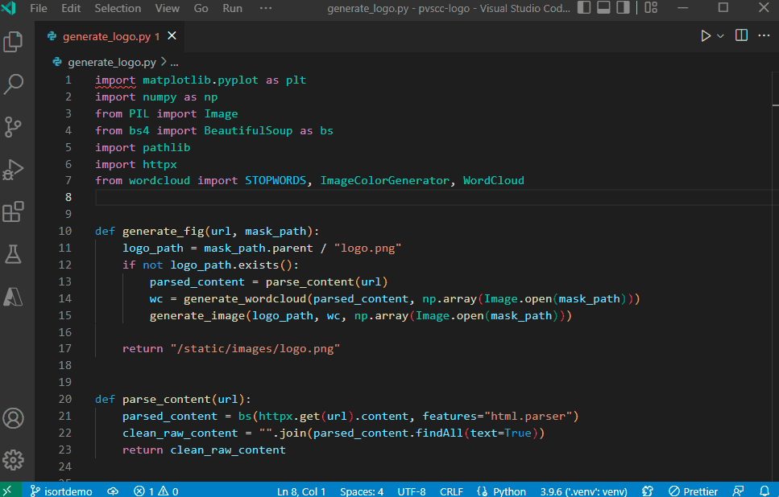

# Import sorting extension for Visual Studio Code using isort

A Visual Studio Code extension that provides import sorting for Python projects using isort. The extension uses the Language Server Protocol ([LSP](https://microsoft.github.io/language-server-protocol/)) to run `isort` in a server-like mode.

This extension ships with `isort=9.0.1`.

> **Note**: The minimum version of isort this extension supports is `8.0.1`. If you have any issues sorting imports with isort, please report it to [this issue tracker](https://github.com/PyCQA/isort/issues) as this extension is just a wrapper around isort.

This extension supports all [actively supported versions](https://devguide.python.org/#status-of-python-branches) of the Python language.

For more information on isort, see https://pycqa.github.io/isort/


## Usage and Features

The isort extension provides a series of import sorting features to help with readability of your Python code in Visual Studio Code. Check out the [Settings section](#settings) below for more details on how to customize the extension.

- **Integrated Import Sorting**: Once this extension is installed in Visual Studio Code, isort is automatically registered as an import organizer. You can use `Shift + Alt + O` to trigger the organize imports editor action. You can also trigger this from the quick fix available when imports are not organized.

- **Customizable isort Arguments**: You can customize the arguments passed to isort by modifying the `isort.args` setting.

- **Import Sorting on Save**: You can enable import sorting on save for Python files by changing the `editor.codeActionsOnSave` setting. It also works alongside the [VS Code Black formatter extension](https://marketplace.visualstudio.com/items?itemName=ms-python.black-formatter) if you set the following settings: 
    
  ```json
    "[python]": {
      "editor.defaultFormatter": "ms-python.black-formatter",
      "editor.formatOnSave": true,
      "editor.codeActionsOnSave": {
          "source.organizeImports": "explicit"
      },
    },
    "isort.args":["--profile", "black"],
  ```





### Disabling isort

If you want to disable isort for your entire workspace or globally, you can [disable this extension](https://code.visualstudio.com/docs/editor/extension-marketplace#_disable-an-extension) in Visual Studio Code.

## Settings

| Settings               | Default                           | Description                                                                                                                                                                                                                                                              |
| ---------------------- | --------------------------------- | ------------------------------------------------------------------------------------------------------------------------------------------------------------------------------------------------------------------------------------------------------------------------ |
| isort.args             | `[]`                              | Arguments passed to isort for sorting imports in Python files. Each argument should be provided as a separate string in the array. <br> Examples: <br> - `"isort.args" = ["--settings-file", "<file>"]` <br> - `"isort.args" = ["--settings-path", "${fileDirname}"]`                                                                                                                                                                          |
| isort.check            | `false`                           | Whether to run `isort --check` on open Python files and report sorting issues as a "Hint" in the Problems window. You can update `isort.severity` to show sorting issues with higher severity.                                                                                                                            |
| isort.severity         | `{ "W": "Warning", "E": "Hint" }` | Mapping of isort's message types to VS Code's diagnostic severity levels as displayed in the Problems window.                                                                                                                                                                   |
| isort.path             | `[]`                              | Path of the isort binary to be used by this extension. Note: This may slow down formatting.<br> Examples: <br>- `isort.path : ["~/global_env/isort"]` <br> - `isort.path : ["conda", "run", "-n", "lint_env", "python", "-m", "isort"]` |
| isort.interpreter      | `[]`                              | Path to a Python executable or a command that will be used to launch the isort server and any subprocess. Accepts an array of a single or multiple strings. When set to `[]`, the extension will use the path to the selected Python interpreter.                                                                                                                   |
| isort.importStrategy   | `useBundled`                      | Defines which isort binary to be used to lint Python files. When set to `useBundled`, the extension will use the isort binary that is shipped with the extension. When set to `fromEnvironment`, the extension will attempt to use the isort binary and all dependencies that are available in the currently selected environment. Note: If the extension can't find a valid isort binary in the selected environment, it will fallback to using the isort binary that is shipped with the extension. The `isort.path` setting may also be ignored when this setting is set to `fromEnvironment`.                                                                                           |
| isort.showNotification | `off`                             | Controls when notifications are shown by this extension. Accepted values are `onError`, `onWarning`, `always` and `off`.                                                                                                                                                                                                                         |
| isort.serverEnabled    | `true`                            | **Experimental** setting to control whether to run isort in a server-like mode. By default `isort` is run behind LSP server, but you can disable this setting to run isort directly. Disabling this setting will also disable import sorting via Code Actions or Organize Imports, but you can still sort imports through the **isort: Sort Imports** command.                                                                                                                                                                                                                           |

## Commands

| Command        | Description                      |
| -------------- | -------------------------------- |
| isort: Restart | Force re-start the isort server. |

## Logging

From the Command Palette (**View** > **Command Palette ...**), run the **Developer: Set Log Level...** command. Select **isort** from the **Extension logs** group. Then select the log level you want to set.

Alternatively, you can set the `isort.trace.server` setting to `verbose` to get more detailed logs from the isort server. This can be helpful when filing bug reports.

To open the logs, click on the language status icon (`{}`) on the bottom right of the Status bar, next to the Python language mode. Locate the **isort** entry and select **Open logs**.

## Development

This extension uses the shared [`vscode-common-python-lsp`](https://github.com/microsoft/vscode-common-python-lsp) TypeScript and Python libraries from the git submodule at `external/vscode-common-python-lsp`. The setup commands below initialize that submodule before npm resolves the local dependency, install and build the shared Node package, install extension dependencies, and bundle the Python libraries.

Prerequisites: Git, Node.js (see `.nvmrc`), and Python 3.10 or later (`python` on Windows or `python3` on macOS/Linux). Setup creates or reuses a project-local `.venv` for Python tools rather than installing into your global Python environment. The nox bundling session uses Python 3.10 and may download that interpreter if it is not already installed.

Clone the repository and enter its directory:

```bash
git clone https://github.com/microsoft/vscode-isort.git
cd vscode-isort
```

Setup initializes submodules automatically. If installing manually instead, initialize (or update) the submodule before installing dependencies:

```bash
git submodule update --init --recursive
```

### Local package feeds

Choose the appropriate setup below before installing dependencies. Committed lockfiles use public npm URLs; Microsoft setup rewrites working copies for proxy installs.

#### Public contributors (non-Microsoft employees)

Use the public setup, which selects `https://registry.npmjs.org/` and `https://pypi.org/simple/` for its child processes. No Microsoft account or internal-feed credentials are needed, and this command works before `node_modules` exists:

From the repository root:

```bash
npm run setup
```

For subsequent npm installs, use `npm ci`. Public contributors do not need the Microsoft feed commands or lockfile hook.

#### Microsoft employees only

> **Microsoft users only:** The commands in this section configure Microsoft package feeds. Public contributors should use the public setup above.

Use the Microsoft setup, which selects `https://packagefeedproxy.microsoft.io/npm/` and `https://packagefeedproxy.microsoft.io/pypi/simple/` for its child processes:

```bash
npm run setup:msft
```

Microsoft setup initializes submodules, then rewrites public npm and Yarn `resolved` URLs in the root and shared TypeScript `package-lock.json` files to the npm proxy before running `npm ci`. Versions, integrity hashes, formatting, and private-feed URLs are preserved. The public setup leaves lockfiles unchanged.

After pulling a new lockfile from GitHub, rerun `npm run setup:msft`, or run the dependency-free rewrite step alone before your next install/build:

```bash
npm run setup:msft-registry
```

The standalone step requires the submodule to be initialized and both lockfiles to exist. Rewriting is idempotent and stops on missing or invalid lockfiles. Keep committed lockfile URLs public using the optional pre-commit hook below (or `npm run normalize-lockfile` for the root lockfile). The shared lockfile belongs to the submodule; do not commit its local proxy URL changes.

For subsequent root npm installs, use:

```bash
npm run ci:msft
```

This rewrites both lockfiles, then runs root `npm ci` with the proxy registry explicitly selected for package, audit, and metadata requests. It requires the submodule to be initialized; use `npm run setup:msft` for full setup, including the shared package and Python dependencies.

Local setup, lockfile rewriting, and `ci:msft` share the feed URLs in `build/package-feeds.json`.

Both setup commands use the same implementation, stop on errors, and keep registry overrides scoped to setup's child processes; they do not change your shell environment, edit `.npmrc`, or add credentials. The standalone rewrite step only edits lockfiles; it does not configure the registry for subsequent commands.

After setup, run `npm run compile` to build the extension. For subsequent Python commands, use `.venv\Scripts\python.exe` on Windows or `.venv/bin/python` on macOS/Linux (or activate that virtual environment). Registry overrides are not retained after setup.

#### Microsoft contributor pre-commit hook

If you use the Microsoft feeds and will commit changes, enable the recommended lockfile hook once per clone (no installed npm dependencies are required). It is not needed just to install or build:

```bash
npm run setup-hooks
```

The installer sets the clone's local `core.hooksPath` to `.githooks`, which also affects its linked worktrees. It refuses to replace an existing hook or a different hooks configuration. If you already use hooks, add `node build/normalize-package-lock.js --staged` to your existing pre-commit hook instead. Only enable this configuration in worktrees/branches that contain these hook files.

Before a local commit, the hook converts known `Pylance_PublicPackages`, `packagefeedproxy.microsoft.io/npm/`, and named `1es-public/npm-public` mirror tarball URLs in the staged root `package-lock.json` to public npm URLs. It preserves versions, integrity hashes, formatting, and intentional Azure-hosted dependencies such as `msft_consumption`. Unknown feeds are left unchanged. It re-stages only the lockfile; if normalization is needed and the lockfile has unstaged changes, the commit is blocked without modifying it. Stage or stash those changes, then retry.

To normalize manually, run `npm run normalize-lockfile`, review the changes, and stage them. To disable the installed hook, run `git config --local --unset core.hooksPath`. These are local Git hooks: GitHub and Dependabot do not execute them. No workflow writes changes to PR branches.

### GitHub Actions package feeds

The PR, push, and CodeQL workflows set `NPM_CONFIG_REGISTRY` to `https://packagefeedproxy.microsoft.io/npm/` and `PIP_INDEX_URL` to `https://packagefeedproxy.microsoft.io/pypi/simple/`. These workflow-level settings also apply to the shared build/lint actions, nested npm commands, and pip installs in nox sessions. The npm endpoint follows the [TypeScript CI package-feed-proxy job](https://github.com/microsoft/TypeScript/blob/main/.github/workflows/ci.yml).

The shared lint and VSIX build actions and the PR TypeScript test job use `npm run ci:msft`, rewriting working-copy lockfile URLs before installation and explicitly selecting the proxy for npm requests. Workflows do not commit these rewrites or change local registry configuration or Dependabot configuration. Existing dependency caches are retained; the VSIX build also retains its offline-cache preference. CodeQL retains workflow-level feed settings for its autobuild step.

### Azure release package feeds

The DevDiv Azure stable/prerelease pipelines pass the npm proxy to their build/publish templates using `customNPMRegistry`. After initializing submodules, their dependency install steps use `npm run ci:msft` to rewrite both npm lockfiles and install through the proxy.

Each Python bootstrap and bundled-library install step explicitly sets `PIP_INDEX_URL` from `PIP_PROXY_INDEX_URL`, selecting the pip proxy even when a template's authentication setup changes the job-level index. Release triggers, approval gates, signing, and publishing behavior are unchanged.

### Localization

The **Localization** GitHub Actions workflow owns English-string submission and translation imports, independently of release builds. It uses `microsoft/vscode-python-extensions-loc` with the existing `src/en/ms-python.isort` and `out/ms-python.isort` layout. The translation backend must be configured to process this repository.

Configure the `PYTHON_LOCALIZATION_APP_ID` Actions variable and the `PYTHON_LOCALIZATION_PRIVATE_KEY` Actions secret in this repository, or expose them through organization variables/secrets. They identify the `python-localization` GitHub App, which must be installed on the localization repository with **Contents: Read and write** permission. The workflow generates a short-lived installation token scoped to that repository; no Azure service connection or personal token is used for localization. The app does not need Pull requests permission.

Pushes to `main` that change English manifest strings, TypeScript sources, the shared Python LSP submodule pointer, or localization tooling run the workflow automatically. Extraction includes both `src` and `external/vscode-common-python-lsp/typescript/src`. Translated JSON updates do not trigger another localization run.

Use **Actions → Localization → Run workflow** to select:

- **sync**: push changed English XLF to the localization repository's `main` branch, then import currently available translations.
- **push**: submit English only, including initial onboarding before translated output exists.
- **pull**: import translations without submitting English.

English submission pushes directly to `main` in the localization repository. Its repository administrators must explicitly allow the app to make these updates under the repository's branch protection and rulesets; the workflow fails if a rule requires a PR. Translation is asynchronous. A commit in the separate localization repository does not trigger this workflow; run **pull** manually after a new handback arrives. Imports require nonempty manifest and runtime tables for all 14 supported locales and fail before replacing tracked files if output is incomplete.

Imports open or update an `automation/localization/<branch>` PR against the selected branch, labeled `debt`, with squash auto-merge enabled subject to required checks and review. Enable **Allow GitHub Actions to create and approve pull requests** in repository Actions settings. The PR uses this repository's `GITHUB_TOKEN`, not the localization app token. GitHub does not automatically trigger PR workflows for changes made with `GITHUB_TOKEN`; a maintainer must close and reopen the PR through GitHub to trigger required PR checks after an update.

Merge translation PRs before releasing. Root `package.nls.<locale>.json` and `l10n/bundle.l10n.<locale>.json` are checked in and included in VSIX packages; DevDiv stable and pre-release builds do not submit or retrieve localization data. The last committed translations provide the initial baseline. If the new repository has only manifest translations, run **push**, wait for the backend to return runtime translations as well, then run **pull**; incomplete handbacks leave the baseline unchanged.
